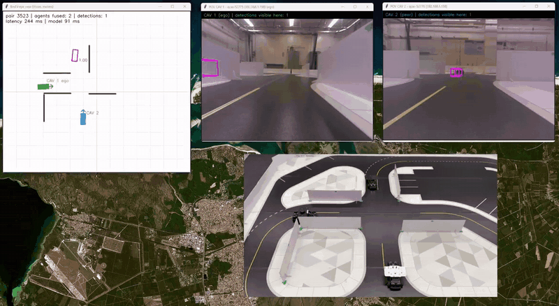

# HEAL on Real Robots — a Physical Cooperative-Perception Testbed with Quanser QCars

Camera-only **cooperative perception on real vehicles**: two Quanser QCar robots share what their front
cameras see, so each can detect cars it cannot see itself — for example a car hidden behind a wall.

This repository is a **fork of [HEAL](https://github.com/yifanlu0227/HEAL)** (Lu et al., *An Extensible
Framework for Open Heterogeneous Collaborative Perception*, ICLR 2024). HEAL was developed and evaluated in
simulation (OPV2V, V2XSet, V2X-Sim, DAIR-V2X). This fork adds everything needed to run it on a physical
testbed: data capture, calibration, dataset building, training, evaluation and live inference.

<p align="center">
  <a href="docs/media/qcar_realtime_through_wall.mp4">
    
  </a>
  <br>
  <em>Live run (<a href="docs/media/qcar_realtime_through_wall.mp4">full video, 82 s</a>): bird's-eye view
  (top left), ego camera and partner camera with the fused detections projected (top), and the lab seen
  from above (bottom). The ego sees only a wall; the box behind it comes from its partner.</em>
</p>

> **Project status — work in progress.** The pipeline runs end to end, from the cars' recordings to live
> fused detection. **Trained checkpoints are not published yet**: we are still improving them (generalisation
> to unseen routes, wall-occlusion labels, more recorded routes). Results will be released with the
> checkpoints.

---

## Installation

The installation is **the same as HEAL's**. Follow the original instructions in the
[HEAL repository](https://github.com/yifanlu0227/HEAL#installation) (a copy is kept in
[`README_HEAL.md`](README_HEAL.md#installation)):

```bash
conda create -n heal python=3.8 pytorch==1.12.0 torchvision==0.13.0 torchaudio==0.12.0 cudatoolkit=11.6 -c pytorch -c conda-forge
conda activate heal
pip install -r requirements.txt
python setup.py develop
pip install spconv-cu116
python opencood/utils/setup.py build_ext --inplace
```

Tested versions: Python 3.8, `torch 1.12.0+cu116`, `spconv-cu116 2.3.6`, on an RTX 3050 (4 GB), RTX 4070
and V100 (Slurm cluster). The camera encoder needs a CUDA GPU.

Raw recordings, built datasets and checkpoints are **not** in git (tens of GB); see
[`qcar_testbed_integration/SCRIPTS.md`](qcar_testbed_integration/SCRIPTS.md).

---

## How the integration works

```
 QCar recordings          conversion              labels                dataset builder                 HEAL
 (ROS bags: cameras  ──►  per-frame folders  ──►  collision labels  ──►  OPV2V-format cooperative  ──►  train / eval /
  + Vicon poses)          (front.png + raw        (which frames are      dataset: GT boxes, visibility,   live inference
                           Vicon pose)            before a contact)      walls, train/val split
```

1. **Capture.** Each QCar records its four CSI cameras and its Vicon pose (and the poses of the other
   cars) into ROS bags. The lab is tracked by a Vicon motion-capture system.
2. **Conversion.** Bags become per-frame folders (`front.png`, `ego_vicon_pose.json`,
   `third_vehicle_vicon_pose.json`, `timestamp.json`). No calibration is applied here: the data stay raw
   and reusable.
3. **Collision labels.** For collision experiments, each run gets `labels/episode_label.json` (the last
   frame before contact). Detection datasets use only the frames before it; collision runs are kept whole.
4. **Dataset builder**
   ([`build_coop_train_val_dataset.py`](qcar_testbed_integration/data/qcar_dataset/pipeline/scripts/build/cooperative/build_coop_train_val_dataset.py)).
   Pairs the cars' frames (within 40 ms), undistorts the fisheye images, places each vehicle's 3D box from
   its Vicon pose plus its measured marker-to-centre offset, decides per agent which vehicles are visible
   (camera projection and real wall occlusion), scales the world ×10 to HEAL's car sizes and writes the
   OPV2V layout HEAL reads, with a per-dataset `modality_assign.json`.
5. **Training and evaluation** ([`qcar/`](qcar/README.md)). `qcar/train.py` and `qcar/eval.py` wrap HEAL
   without modifying `opencood/`; plugins adapt it to one front camera and to the QCar's real camera
   geometry. `qcar/zoo.py` trains HEAL's fusion methods (att, max, DiscoNet, V2X-ViT, V2VNet, CoBEVT,
   Where2comm, Who2com, CoAlign, Pyramid) with one recipe, starting from HEAL's released OPV2V checkpoints.
6. **Live inference** ([`qcar/realtime/`](qcar/README.md)). Reads both cars' ROS streams, builds each pair of
   frames exactly as the offline pipeline does, runs fused detection and shows the viewer of the video.

### Where each fact lives

Every fact lives in one file; the rest reference it.

| What | File |
|---|---|
| Car identity, current IP, camera extrinsics | [`qcar_testbed_integration/calibration/vehicles.json`](qcar_testbed_integration/calibration/vehicles.json) |
| Vicon-to-car-centre offsets and box size (measured) | [`qcar_testbed_integration/calibration/physical_vehicle_footprints.json`](qcar_testbed_integration/calibration/physical_vehicle_footprints.json) (SHA256-checked) |
| Camera intrinsics (fisheye, verified) | `qcar_testbed_integration/calibration/calibration_Matries/<car>/latest_front/` |
| Lab walls and parked cars | [`qcar_testbed_integration/data/qcar_dataset/pipeline/shared/scene.json`](qcar_testbed_integration/data/qcar_dataset/pipeline/shared/scene.json) |
| Paths, sessions, train/val split of a build | each script's `conf.json` (repo-relative paths; machine-specific ones via an untracked `machine_paths.json`) |
| HEAL training recipe (shared by all fusion methods) | [`qcar/configs/camera_attfuse_coop.yaml`](qcar/configs/camera_attfuse_coop.yaml) + [`qcar/zoo.json`](qcar/zoo.json) |

---

## Repository layout

| Path | Contents |
|---|---|
| `opencood/` | HEAL, **unchanged** from upstream |
| `qcar/` | Training, evaluation, model zoo, round-by-round replay, live inference — imports `opencood`, never edits it. See [`qcar/README.md`](qcar/README.md) |
| `qcar_testbed_integration/` | Everything upstream of HEAL: recording tools, calibration, bag conversion, dataset builders, diagnostics. Index: [`SCRIPTS.md`](qcar_testbed_integration/SCRIPTS.md) |
| `qcar_rounds.ipynb` | Replays validation trajectories round by round: cameras, BEV features, boxes vs. ground truth |
| `docs/media/` | Demo video |
| `README_HEAL.md` | The original HEAL README (methods, datasets, checkpoints, citation) |

## Quick start

```bash
# build a cooperative dataset (defaults in its conf.json)
python qcar_testbed_integration/data/qcar_dataset/pipeline/scripts/build/cooperative/build_coop_train_val_dataset.py

# train and evaluate one model, or the whole zoo
python qcar/train.py
python qcar/eval.py --model_dir <run_dir> --split validate
python qcar/zoo.py configs && python qcar/zoo.py train

# live inference on the cars
python -m qcar.realtime.run
```

---

## Team

Developed by **Kevin Saavedra** (MSc, University of Calabria), with **Daryel León** (PhD student, Concordia
University) and **Wissam Fawaz** (Lebanese American University). Supervisors: **Chadi Assi** (Concordia
University) and **Floriano De Rango** (University of Calabria). Part of the **MITACS** program.

## Credits and license

Built on **HEAL** by Yifan Lu et al. The HEAL code (`opencood/`) keeps its original license
([`LICENSE`](LICENSE)). If you use this work, please cite HEAL:

```bibtex
@inproceedings{
lu2024an,
title={An Extensible Framework for Open Heterogeneous Collaborative Perception},
author={Lu, Yifan and Hu, Yue and Zhong, Yiqi and Wang, Dequan and Chen, Siheng and Wang, Yanfeng},
booktitle={The Twelfth International Conference on Learning Representations},
year={2024},
}
```
